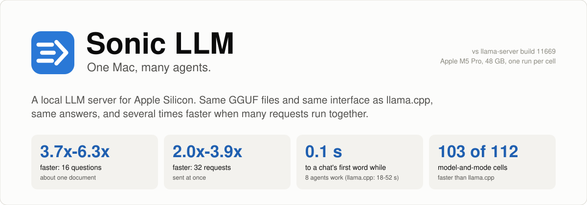
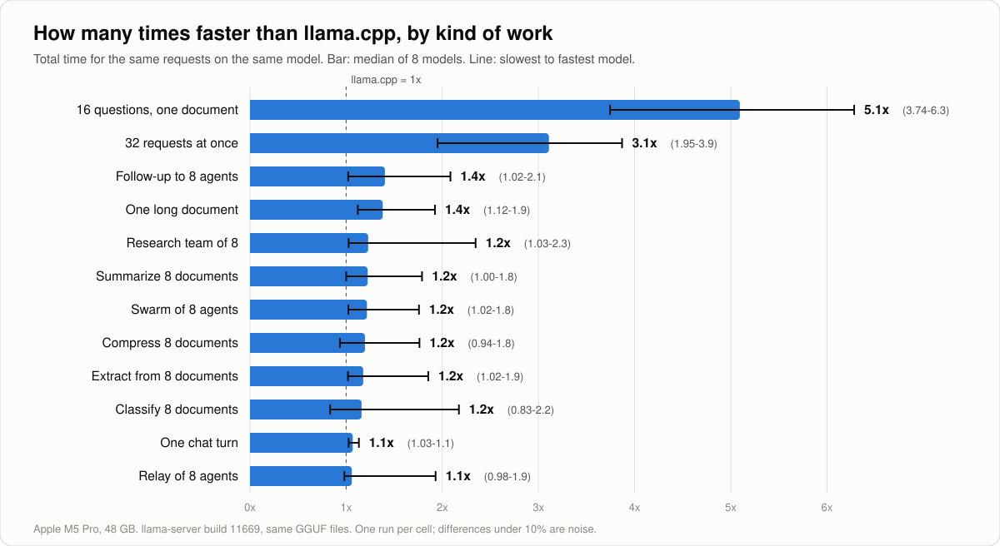
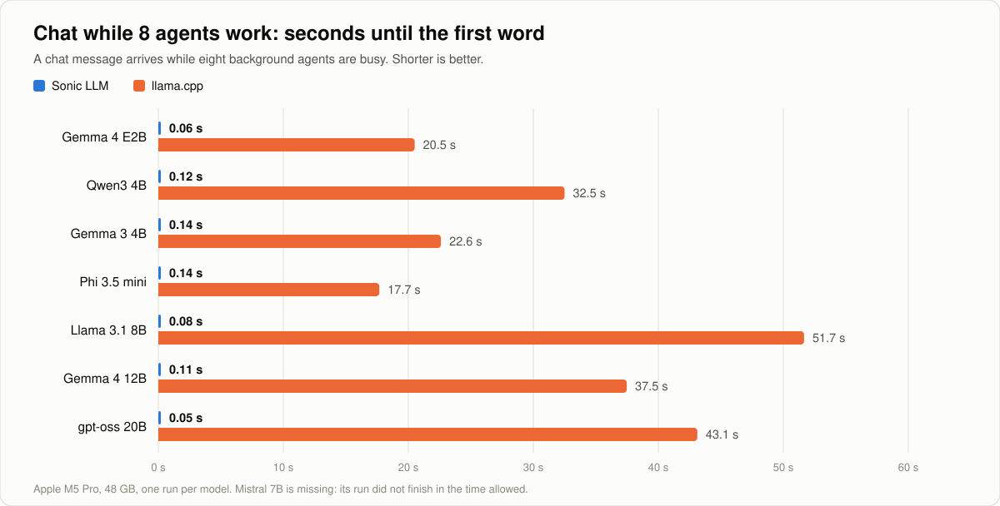
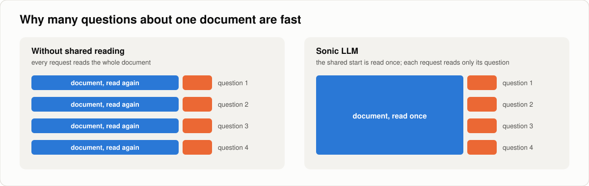
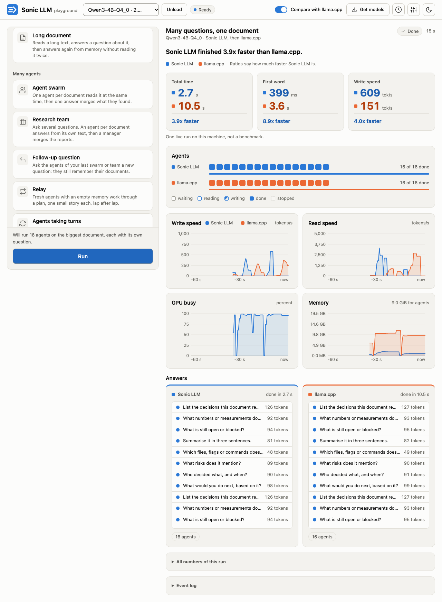

<picture>
  <source media="(prefers-color-scheme: dark)" srcset="docs/assets/banner-dark.svg">
  
</picture>

# Sonic LLM

**A local LLM server for Apple Silicon, built for many agents at once.**
It loads the GGUF files you already have, speaks the same HTTP interface as llama.cpp's `llama-server`, and gives the same answers. It is about as fast for one chat and several times faster when many requests run together.

```sh
sllm-server -m Qwen3-4B-Q4_0.gguf -c 8192 --port 8080
```

Point any OpenAI-style client, the llama.cpp web tools, or Claude Code at `http://localhost:8080` and keep working.

## Why you would want it

Measured against `llama-server` on the same Mac, the same model files and the same requests (Apple M5 Pro, 48 GB; eight models from 2B to 20B; one run per cell):

| What you do | Sonic LLM vs llama-server |
|---|---|
| Ask 16 questions about one document | **3.7x to 6.3x faster** |
| Send 32 short requests at once | **2.0x to 3.9x faster** |
| Chat while 8 agents work in the background | first word in **0.05-0.14 s**, instead of 18-52 s |
| Ask 8 agents a follow-up question | 1.02x to 2.1x faster |
| Read one long document | 1.12x to 1.9x faster |
| 8 agents, a document each (swarm, team, summarize, extract) | 1.0x to 2.3x faster |
| One plain chat turn | 1.03x to 1.13x (call it the same) |

<picture>
  <source media="(prefers-color-scheme: dark)" srcset="docs/assets/speedup-dark.svg">
  
</picture>

<picture>
  <source media="(prefers-color-scheme: dark)" srcset="docs/assets/first-word-dark.svg">
  
</picture>

Across 112 model-and-mode cells Sonic LLM was faster in 103, within 2% in 4, slower in 4, and one did not finish. The full tables, with read speed, write speed and first-token time for every model and mode, are in [docs/benchmarks.md](docs/benchmarks.md), including the cells where llama.cpp is ahead.

**Same answers.** Speed here never comes from changing the model. The engine is checked against reference outputs on nine models after every change, and a request gives the same tokens alone or next to other agents. Options that trade exactness for speed exist, and they are off until you turn them on.

## How it gets there

<picture>
  <source media="(prefers-color-scheme: dark)" srcset="docs/assets/shared-reading-dark.svg">
  
</picture>

- **Shared reading.** When requests start with the same text (a system prompt, a document, a tool list), that start is read once and every request continues from it.
- **A fast lane for the person at the keyboard.** Chat requests and background agents are scheduled separately, so a chat gets its first word in a fraction of a second while a swarm is running.
- **Agents that keep their memory.** An agent's context stays in memory between turns, so a follow-up reads only the new question. Idle agents are parked on the SSD and woken when their turn comes, which is how hundreds of agents fit beside one model.
- **Its own Metal engine.** The compute core is written for Apple GPUs and for batches of many sequences, with kernels chosen per model family. Dense models, mixture-of-experts models (Qwen3.6 35B-A3B, gpt-oss) and sliding-window models (Gemma 3 and 4) all run natively.
- **A guess head for writing.** For models whose makers publish a multi-token prediction head, the engine drafts the next tokens with it and verifies them, so the output is identical and arrives faster.

## Quick start

Requirements: a Mac with Apple Silicon, Xcode command line tools, Rust.

```sh
git clone https://github.com/benrben/sonic-llm && cd sonic-llm/engine
./vendor/ggml-b11669/fetch.sh            # downloads llama.cpp's official ggml libraries (checksums verified)
./vendor/ggml-rowexact-b11669/build.sh   # builds the Metal backend with our kernels on top
cargo build --release -p sllm-server
./target/release/sllm-server -m /path/to/model.gguf --port 8080
```

Check it:

```sh
curl localhost:8080/health
curl localhost:8080/v1/chat/completions -H 'Content-Type: application/json' -d '{
  "messages": [{"role": "user", "content": "Explain what a GGUF file is in two sentences."}],
  "max_tokens": 200
}'
```

## Using it

### As a drop-in for llama-server

The flags you already use work: `-m`, `-c`, `-t`, `--host`, `--port`, `--alias`, `--api-key`. Flags that only switch on things Sonic LLM always does (`-ngl`, `--jinja`, `-fa`, `-cb`, `--metrics`, `--slots`) are accepted and ignored with a note. The endpoints are the same: `/completion`, `/tokenize`, `/detokenize`, `/apply-template`, `/props`, `/slots`, `/health`, `/v1/models`, `/v1/completions`, `/v1/chat/completions`, with streaming, tools, grammars, JSON schemas and token probabilities.

We sent 40 identical requests to both servers and compared every answer field by field: 35 behave the same (ten of them differ only in that thinking is off here unless you ask for it), and 4 ask for things Sonic LLM does not have yet (`/infill`, `/v1/responses`, slot save files, sampling penalties). The whole list is in [docs/llama-server-compat.md](docs/llama-server-compat.md).

Two differences matter most:

- **Answers are deterministic.** The engine always picks the most likely token; `temperature`, `top_p`, `top_k` and `seed` are accepted and have no effect.
- **Unknown request fields are refused** with an error that names the field, instead of being silently dropped.

### With the OpenAI client

```python
from openai import OpenAI

client = OpenAI(base_url="http://localhost:8080/v1", api_key="none")
stream = client.chat.completions.create(
    model="local",
    messages=[{"role": "user", "content": "Write a haiku about a fast server."}],
    stream=True,
)
for chunk in stream:
    print(chunk.choices[0].delta.content or "", end="", flush=True)
```

### With Claude Code and other Anthropic-style clients

The server also speaks the Anthropic Messages interface (`/v1/messages`, `/v1/messages/count_tokens`):

```sh
ANTHROPIC_BASE_URL=http://localhost:8080 ANTHROPIC_API_KEY=none claude
```

### Many agents at once

Send the requests together; there is nothing to configure. Mark work that nobody is waiting on as background, so a person chatting on the same server stays first in line:

```python
import asyncio
from openai import AsyncOpenAI

client = AsyncOpenAI(base_url="http://localhost:8080/v1", api_key="none")
document = open("contract.txt").read()
questions = ["Who are the parties?", "What is the term?", "How can it be ended?", "What are the payment dates?"]

async def ask(q):
    r = await client.chat.completions.create(
        model="local",
        messages=[{"role": "system", "content": document}, {"role": "user", "content": q}],
        max_tokens=200,
        extra_body={"lane": "background"},
    )
    return r.choices[0].message.content

answers = asyncio.run(asyncio.gather(*map(ask, questions)))
```

The document is read once for all four questions. This is the "16 questions about one document" row above.

To size the server for a job, say how many agents and how much context each needs, and let it choose the rest:

```sh
sllm-server -m model.gguf --auto-mode --agents 64 --ctx 8192
```

### Answer levels

One field picks how much work goes into an answer:

```sh
curl localhost:8080/v1/chat/completions -H 'Content-Type: application/json' -d '{
  "messages": [{"role": "user", "content": "A train leaves at 9:40 and arrives at 13:05. How long is the trip?"}],
  "level": "normal"
}'
```

| Level | What it does | Accuracy | Time per answer |
|---|---|---|---|
| `sonic` | one short line | 78.0% | 0.54 s |
| `fast` | an ordinary chat answer | 93.5% | 3.0 s |
| `normal` | two quick answers; when they disagree, a careful step-by-step one | 96.0% | 2.6 s |
| `deep` | same as `normal` today; a long-work level is being built | 96.0% | 2.6 s |

Measured on 200 questions (170 grade-school math, 30 medical exam) with Qwen3.6 35B-A3B on the M5 Pro.

### Long-lived agents

For agents that live across many turns there is a small agent interface next to the chat one: create an agent (or fork one from another agent's memory without reading anything again), send it turns and tool results, suspend it to the SSD, wake it just before it is needed, and compact its history when the context fills. A turn answers as an event stream, like `/completion` with `"stream": true`.

```sh
curl -X POST localhost:8080/v1/agents -d '{"lane": "background"}'             # -> {"id": "..."}
curl -X POST localhost:8080/v1/agents/$ID/turn -d '{"messages": [{"role": "user", "content": "Read this report: ..."}]}'
curl -X POST localhost:8080/v1/agents/$ID/suspend -d '{"tier": "ssd"}'
curl -X POST localhost:8080/v1/agents/$ID/wake
curl -X POST localhost:8080/v1/agents -d '{"from_agent": "'$ID'"}'            # a second agent with the same memory
```

### Small jobs without a prompt

Start the server with a second, small model (`--helper-model small.gguf`) and four endpoints do common document jobs directly and return structured results: `/v1/helper/classify` (labels with probabilities), `/v1/helper/extract` (named fields), `/v1/helper/summarize`, and `/v1/helper/compress` (keep the parts of a long text that matter for a question).
```sh
curl localhost:8080/v1/helper/classify -d '{"text": "The package arrived broken.", "labels": ["complaint", "praise", "question"]}'
```

## Playground

A web page that runs next to the engine: pick a model (or search Hugging Face and download one from the page), pick one of 15 tests, and watch Sonic LLM run it live, side by side with llama.cpp if you have `llama-server` installed.

```sh
cd playground
uv run sonic-playground          # then open http://localhost:8000
```



The numbers on the page are one live run on your machine, not a benchmark. Details and settings are in [playground/README.md](playground/README.md).

## More results

**Big mixture-of-experts model, writing.** Qwen3.6 35B-A3B with its makers' prediction head (a 704 MB side file next to the model): 128-137 tokens per second, against 73-81 on the same engine with the head off. Forty answers out of forty were token-identical with the head on and off.

**Short prompts.** A prompt start shared by recent requests is kept ready: 123-token prompts read 29% faster on the 35B model (106 to 82 ms), answers unchanged.

**Follow-ups on sliding-window models.** A repeated or continued request on Gemma 3, Gemma 4 and gpt-oss starts writing in 0.04-0.10 s instead of 1.2-4.6 s, because the memory behind the window is kept.

## Compared with other ways to run a model locally

| Server | Compared here? | What we can say |
|---|---|---|
| llama.cpp (`llama-server`) | Yes: 8 models, 14 kinds of work, same files, same requests | Everything on this page and in [docs/benchmarks.md](docs/benchmarks.md) |
| Ollama, LM Studio | Not measured | Both can run GGUF models through llama.cpp, so the llama.cpp numbers are the nearest guide, but we have not run them and make no claim |
| MLX (`mlx_lm.server`) | Not measured | It uses a different model format, so a fair comparison needs its own protocol |

If you measure Sonic LLM against any of these, we would like to see your numbers.

## Where llama.cpp is still ahead, and other limits

- **Four cells of 112.** Mistral 7B (Q4_K_M) is slower in three 8-agent modes (classify 0.83x, exactness run 0.87x, compress 0.94x) and Llama 3.1 8B in one (compress 0.98x). Mistral's chat-under-load run did not finish in the time allowed.
- **One plain chat is about a tie.** The wins are in parallel work, shared prompts and follow-ups.
- **A cold, short prompt on the 35B model is not read faster than llama.cpp.** Reading has a fixed cost of about 35 ms there; from about 400 tokens up it is ahead.
- **Early writers in a burst.** When a group of agents arrives together, one that finishes reading first writes slowly until the rest have read. Total time is what this optimizes.
- **Apple Silicon only**, and all numbers are from one M5 Pro with 48 GB. Smaller Macs have not been measured.
- **No sampling yet.** Decoding is greedy, so the same request always gives the same answer; temperature and the other sampling settings have no effect.
- **Not supported:** embeddings, reranking, image input, LoRA adapters, code infill, the Responses interface. See the [compatibility page](docs/llama-server-compat.md).
- Memory use is not compared here yet; a measurement that is fair to both servers is still to be done.

## License

MIT. See [LICENSE](LICENSE). The vendored llama.cpp and ggml headers keep their own MIT license ([engine/vendor/LICENSE.llama.cpp](engine/vendor/LICENSE.llama.cpp)).

## Credits

Sonic LLM reads GGUF files and tokenizes with code from [llama.cpp](https://github.com/ggml-org/llama.cpp) and ggml, and llama.cpp is the reference every result here is checked against. The compute engine, the scheduler and the agent memory are new.
